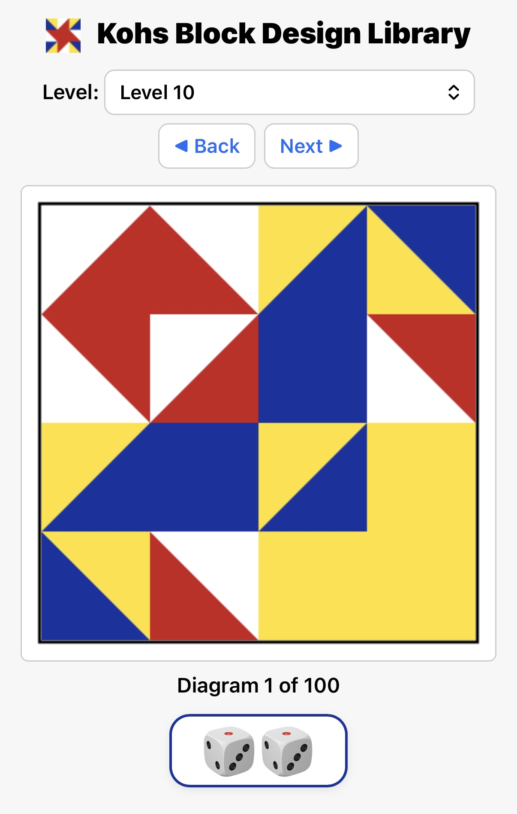

# Kohs
Games and 3d scad projects Inspired by Samuel C. Kohs Block Design Cubes.  

The web page at https://jimb15122.github.io/Kohs/
contains a library of over 1000 cube block design patterns organized (somewhat) by difficulty level.  The diagrams, when combined with a set of 16 original Kohs blocks, can be used for competitive game play.

A color 3mf model is available for download in this repository. A pdf version can also be printed and folded.  You will need to make at least 4 cubes to start at the easy levels.  16 cubes are needed (per player) for the advanced levels.

Game play: 
The game can be played in 2 different ways.  

1. All players solve the same 
pattern concurrently, the first to finish wins that round.

There can be 1 or more screens using the library app to display the same pattern.  The difficulty level is selected by agreement of all players for each round.  

The pattern for a round can be selected either randomly (if using only 1 screen) or sequentially, but it should not be displayed until all players are ready to start the round.  If multiple screens are in use, then the random option cannot be used; simultaneously press "next" after a countdown to start the round.

Game is over when a player is first to win an agreed upon number of rounds.

2. Race Mode
Each player has their own screen, running the web diagram library app, with a randomly selected problem to solve.
  
At the start of the game, all players start at the same agreed-upon difficulty level and then randomly select a diagram within that level. (on the count off three).  First player to solve their diagram correctly wins the round.  The winning player then MUST advance to the next level, while others stay at their current level.  The remaining players can be permitted to finish their diagram before starting the next round.  

The first player to advance through an agreed-upon number of levels wins the game.

